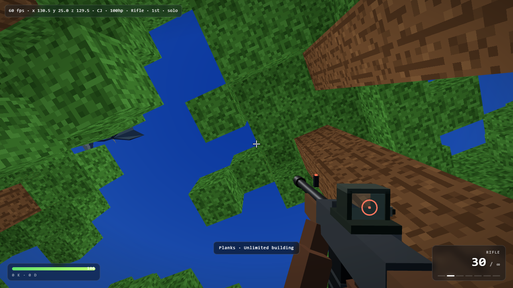

# Blockcraft Battle Ground

A tiny procedurally generated voxel world with online gunfights.

Everything is generated in the browser from one seed — terrain, biomes, trees, waterfalls,
mudbrick Fayoum villages, chickens, villagers and seven textured characters — and you can
shoot your friends in it. No build step, no dependencies, no assets: just HTML, CSS and
JavaScript on top of [three.js](https://threejs.org).



## Play

**Hosted:** <https://elsharqia-games.github.io/blockcraft-battle-ground/>

**Offline / local:** double-click `index.html`. It runs straight from `file://` and still
loads three.js from a CDN, so you need an internet connection the first time (or a cached copy).

**LAN server (also serves the files):**

```bash
npm start          # or: node server.js
# then open http://localhost:8080
```

On Windows you can also double-click `start.bat`.

## Play with a friend

### Internet (no server needed)

1. Both of you open the same page (`index.html` or the hosted link).
2. One player clicks **Create room** — a 5-character code is generated and copied.
3. Send the code to your friend. They type it into the room box and click **Join room**.
4. You are in the same gunfight. `P` copies the room code again, `M` mutes sound.

Rooms travel over public MQTT-over-WebSocket relays (`broker.emqx.io`, then
`broker.hivemq.com` as a fallback), so there is no server to host — but the relay is public,
so do not treat rooms as private. Room codes match sessions; both players need this game.
Block edits are retained per room, so a friend who joins later still sees the world you
changed.

You can also link straight into a room: `index.html?room=CODE`.

### LAN / same machine

Run `node server.js` and open `http://localhost:8080`; the built-in zero-dependency
WebSocket server relays positions, shots, damage and edits. Friends on the same network open
`http://YOUR-LOCAL-IP:8080` (or pass `?server=ws://YOUR-LOCAL-IP:8080`).

## Controls

| Input | Action |
| --- | --- |
| `W A S D` | Move |
| Mouse | Look |
| Left click | Shoot |
| Right click | Aim down sights |
| `R` | Reload |
| `Q` / `1` `2` `3` / wheel | Swap weapon (pistol, rifle, shotgun) |
| `B` | Toggle build mode (combat ↔ blocks) |
| `E` | Inventory & crafting |
| `Space` | Jump / swim |
| `Shift` | Sprint |
| `V` | First / third person |
| `C` | Swap character |
| `F` | Toggle flying |
| `M` | Mute sound |
| `P` | Copy room code |
| `Esc` | Pause / release mouse |

## What is in it

- **World** — 256×256×80 voxel world from a seeded value-noise heightmap, with grass,
  forest, desert, snow and ocean biomes, 880 trees, cacti, waterfalls, and 5 mudbrick
  villages inspired by El Fayoum, each with houses, palms and villagers.
- **Characters** — seven textured, animated humanoids (Steve, CJ, Mario, Ashen One, Chosen
  Undead, the Wolf, Tarnished) painted procedurally onto a pixel-art atlas, plus chickens
  and wandering villagers.
- **Combat** — three weapons with distinct damage, rate of fire, spread, recoil and range;
  hitscan with headshot multipliers, tracers, muzzle flash, impact particles, synthesized
  WebAudio gunshots, health with regeneration, kill feed, K/D, death and respawn.
- **Building** — break and place 21 block types, inventory, hotbar and nine crafting recipes.
- **Networking** — one transport interface with two back ends: the LAN WebSocket server
  (`server.js`) and internet MQTT rooms. Remote players are interpolated with name tags and
  held weapons, block edits sync both ways, and late joiners get retained edits.

## Project layout

```
index.html          markup, styles and the boot loader (imports three.js, loads src/*.js)
src/00-core.js      world constants, renderer, scene, camera, sky
src/10-textures.js  procedural block atlas, block definitions, voxel storage
src/20-world.js     noise, biomes, terrain, trees, villages, waterfalls
src/30-meshing.js   face meshing and chunk rebuilds
src/40-characters.js characters, pixel-art painters, villagers, chickens
src/50-player.js    player physics, camera, avatar, block picking, spawn
src/60-combat.js    weapons, models, audio, effects, hit tests, health, death
src/70-inventory.js inventory, hotbar, crafting
src/80-input.js     pointer lock, mouse, keyboard, resize
src/90-net.js       LAN WebSocket + MQTT transport, rooms, remote players
src/99-boot.js      boot sequence and main loop
server.js           zero-dependency static + WebSocket LAN server
```

The `src/` files are plain classic scripts loaded in order, which is what lets the game run
by double-clicking `index.html` — no bundler, no dev server, no modules over `file://`.
Top-level `const`/`let` are shared between them through the global lexical scope. See
`index.html` for the loader.

## Notes

- three.js r160 is loaded from jsDelivr (unpkg as fallback).
- The internet mode needs a WebSocket-capable network; restrictive firewalls can block the
  public brokers, in which case use the LAN server.
- Deployed with GitHub Pages from the repository root.

## License

MIT — see [LICENSE](LICENSE).
